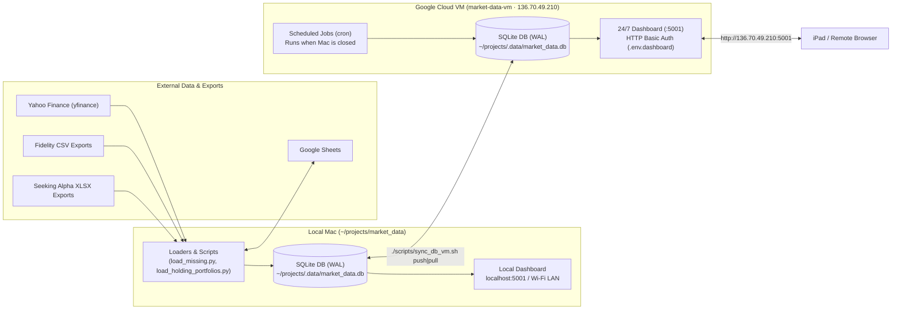

# market_data

Equities market data pipeline, quantitative period-ranking filter, and Portfolio Valuation Dashboard.

---

## Architecture Overview



- **Local Mac & Wi-Fi LAN**: Run the dashboard (`http://localhost:5001` or `http://<mac-lan-ip>:5001`) without authentication for local development and same-Wi-Fi device access.
- **Google Cloud VM (`market-data-vm`, `e2-micro` in `us-west1-b`)**: Hosts a copy of `market_data.db` and the Python codebase so scheduled jobs (e.g., `load_missing.py`) can run even when macOS is closed, and serves the dashboard 24/7 at `http://136.70.49.210:5001` (protected by HTTP Basic Auth via `.env.dashboard`) for remote/iPad access.

---

## Developer Setup

### 1. Virtual Environment Activation
To run Python scripts or tests with project-specific dependencies:
```bash
source .venv/bin/activate
```

### 2. Running the Test Suite
The testing framework is `pytest` (all database tests use isolated in-memory SQLite fixtures):
```bash
.venv/bin/python -m pytest
```

### 3. Database Setup (SQLite)
This project uses SQLite in WAL mode (`PRAGMA journal_mode=WAL`) for storing daily close prices, Fidelity position snapshots, ticker metadata, and period rank filter results.
- Configured via `os.environ.get('SQLITE_DB_PATH')` and `os.path.expanduser(...)`.
- Defaults to `~/projects/.data/market_data.db` (resolves to `/Users/<user>/projects/.data/market_data.db` on macOS and `/home/<user>/projects/.data/market_data.db` on the Linux VM).

---

## Google Cloud VM Operations

- **GCP Project**: `market-data-vm-pm2026`
- **VM Instance**: `market-data-vm` (`us-west1-b`, external IP `136.70.49.210`)
- **Remote Dashboard**: `http://136.70.49.210:5001` (credentials configured on VM in `~/projects/market_data/.env.dashboard`)

Common commands from your Mac:
```bash
# SSH into the VM
ssh market-data-vm.us-west1-b.market-data-vm-pm2026

# Sync SQLite database between Mac and VM (uses atomic sqlite3 .backup + integrity_check)
./scripts/sync_db_vm.sh push
./scripts/sync_db_vm.sh pull

# Start/restart the dashboard in the background on the VM
ssh market-data-vm.us-west1-b.market-data-vm-pm2026 \
  "cd ~/projects/market_data && (pkill -f '[p]ortfolio_dashboard.py' || true) && ./scripts/run_dashboard.sh"
```
